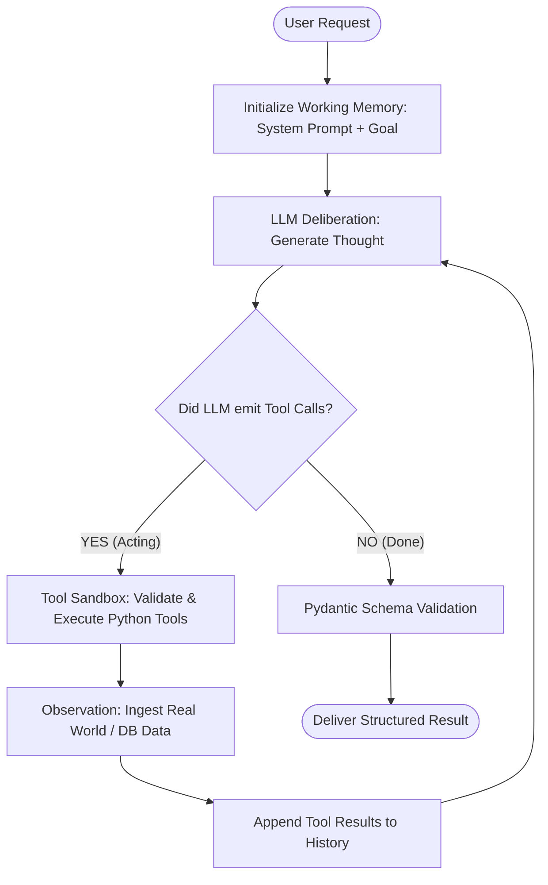
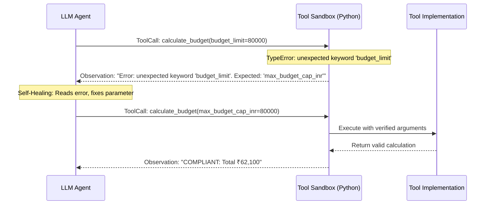

# 🧠 Agentic AI Engineering Cheatsheet (Level 1: ReAct & Tool Engine)

A high-density reference guide summarizing the fundamental concepts, design patterns, wire protocols, and code architectures learned in **TripMind V1**.

---

## 1. The Core Paradigm Shift

| Feature | Traditional LLM Prompting | Autonomous ReAct Agent |
| :--- | :--- | :--- |
| **Execution Model** | Single-shot, open-loop: $\text{Prompt} \to \text{LLM} \to \text{Output}$ | Multi-turn, closed-loop state machine |
| **Reasoning Flow** | Generates final answers immediately | Cycles through: **Thought $\to$ Action $\to$ Observation** |
| **Handling Missing Data** | Hallucinates or guesses plausibility | Emits an **Action** to fetch ground truth from tools |
| **Arithmetic & Math** | Stochastic token sampling (unreliable) | Invokes deterministic code (Python / SQL) |
| **Self-Correction** | Cannot verify its own mistakes | Observes tool errors and self-heals in the next turn |

---

## 2. The ReAct Loop (Reasoning + Acting)



1. **Thought (Reasoning)**: The LLM articulates internal deliberation within `<thought>...</thought>`.
2. **Action (Acting)**: The LLM selects a specific tool and generates JSON parameters.
3. **Observation (Perception)**: Deterministic code executes the action and injects the ground truth back into working memory.
4. **Reflection & Self-Correction**: The LLM reads the observation. If an error occurred, it corrects its arguments and tries again.
5. **Synthesis**: Once all constraints and data are collected, the model formats the final answer.

---

## 3. Universal Message Roles & Wire Mapping

LLMs communicate via turn-based arrays. Different providers use slightly different wire schemas, but all map to four canonical concepts:

| Canonical Role | Groq / OpenAI Standard | Google Gemini (`google-genai`) | Semantic Purpose |
| :--- | :--- | :--- | :--- |
| **`system`** | `{"role": "system", "content": "..."}` | `config.system_instruction = "..."` | Grounding rules, persona, and negative constraints |
| **`user`** | `{"role": "user", "content": "..."}` | `types.Content(role="user", parts=[...])` | The human user's prompt |
| **`assistant`** / **`model`** | `{"role": "assistant", "tool_calls": [...]}` | `types.Content(role="model", parts=[...])` | The model's own thought and function call decisions |
| **`tool`** | `{"role": "tool", "tool_call_id": ..., "content": ...}` | `types.Content(role="user", parts=[Part.from_function_response(...)])` | The deterministic return value from a tool |

### ⚠️ The Turn-Ordering Rule
In all LLM APIs, **an Assistant message with `tool_calls` MUST precede the Tool responses that answer those calls**:

$$\text{User Turn} \longrightarrow \mathbf{\text{Assistant Turn (tool\_calls)}} \longrightarrow \mathbf{\text{Tool Response Turn(s)}}$$

#### Idiomatic Implementation Pattern:
Append the Assistant turn **first**, then execute tools and append observations:
```python
# 1. Append Assistant Turn FIRST
messages.append({
    "role": "assistant",
    "content": f"<thought>{thought}</thought>",
    "tool_calls": assistant_tool_calls,
})

# 2. Execute tools and append observations
for tc in turn_response.tool_calls:
    obs = registry.execute(tc.name, tc.arguments)
    messages.append({
        "role": "tool",
        "tool_call_id": tc.call_id,
        "name": tc.name,
        "content": obs,
    })
```

---

## 4. Tool Reflection & Dynamic Schema Generation

In robust agent frameworks, tools are **not** manually written in prompt text. Code inspects Python functions at runtime:

```python
import inspect
from pydantic import create_model

# 1. Inspect Python function signature and type hints
sig = inspect.signature(func)
fields = {
    param_name: (param.annotation, param.default if param.default != inspect.Parameter.empty else ...)
    for param_name, param in sig.parameters.items()
}

# 2. Dynamically generate OpenAPI / JSON Schema Draft 7
dynamic_model = create_model(f"{func.__name__}_Args", **fields)
json_schema = dynamic_model.model_json_schema()
```

* **Inbound Contract**: JSON Schema tells the LLM what parameter names, data types, and required fields are expected.
* **Outbound Contract**: Pydantic return schemas (`RegionSearchResult`, `RouteResult`) serialize into structured JSON observations that the LLM can reliably parse.

---

## 5. Structured Outputs & Constrained Decoding

| Mechanism | Reliability | How It Works Under the Hood |
| :--- | :--- | :--- |
| **Prompt Instructions** (*"Return JSON only"*) | ⚠️ Low (~85-92%) | Pure token prediction. Susceptible to markdown blocks, hallucinations, and syntax errors. |
| **Pydantic Validation (App Layer)** | 🛡️ Safe | Validates at runtime (`TripPlanResponse(**data)`). Raises errors if invalid. |
| **Constrained Decoding / CFG** (*`strict: true` or `response_schema`*) | 🔒 100% Guaranteed | **Context-Free Grammar (CFG)** masks illegal token logits to $-\infty$ during sampling. Mathematical syntax guarantee. |

### Does an LLM Guarantee Valid Tool Arguments?
**No.** By default:
1. LLMs can hallucinate parameter names (e.g., `budget_limit` instead of `max_budget_cap_inr`).
2. LLMs can confuse types (e.g., passing `"5"` instead of `5`).
3. LLMs cannot verify semantic business rules (e.g., negative numbers, nonexistent cities).

---

## 6. The Defensive Sandbox & Self-Healing Loops

> **Golden Rule of Agentic AI**: Treat all LLM outputs like untrusted user input from the internet.



Instead of crashing your web server, intercept exceptions and feed them back as **Observations**. The LLM reads the stack trace or parameter hint and corrects itself on the next turn.

---

## 7. Negative Constraint Enforcement

* **The Problem**: Standard LLMs suffer from "frequency bias." If a traveler goes to Gulmarg in winter, the LLM will recommend skiing or snowmobiling because they are popular, even if the prompt explicitly stated *"no adventure sports"*.
* **The Solution**: Programmatic filtering in deterministic tools.
  ```python
  if exclude_adventure:
      query = query.filter(ActivityModel.is_adventure == False)
  ```
  Never rely solely on prompt reminders for safety-critical negative constraints; enforce them in the deterministic data layer.

---

## 8. Provider Abstraction & The Mock Provider

### Model-Agnostic Architecture
Agents should never be hard-coded to a single LLM vendor. Wrap all models behind a unified interface:

```python
class BaseLLMProvider(ABC):
    @abstractmethod
    def generate_turn(self, messages: List[Dict], tools: List[Tool]) -> LLMTurnResponse:
        pass
```

### The Value of Deterministic Mock Providers:
1. **Zero Token Cost**: Run 50 unit tests in 0.3 seconds without paying API fees.
2. **CI/CD Reliability**: Tests never fail due to API rate limits (HTTP 429), latency spikes, or upstream outages.
3. **Reproducibility**: Simulates the exact step-by-step reasoning progression of frontier models.
4. **Seamless Local Dev**: Enables frontend and database development before plugging in paid API keys.

---

## 9. Key Architectural Rules for Production Agents

1. **Keep Tools Deterministic**: Tools should do one thing well (fetch data, run arithmetic, query a database) and return structured output.
2. **Cap Agent Iterations**: Always set a hard ceiling (`max_iterations = 10`) to prevent infinite hallucination loops and runaway token bills.
3. **Log the Explainable Trace**: Store `step_number`, `thought`, `tool_name`, `tool_input`, and `observation` for full observability.
4. **Isolate Database Infrastructure**: Use dedicated Docker containers and non-default ports (e.g. Port 5433) to prevent collisions with other local services.
