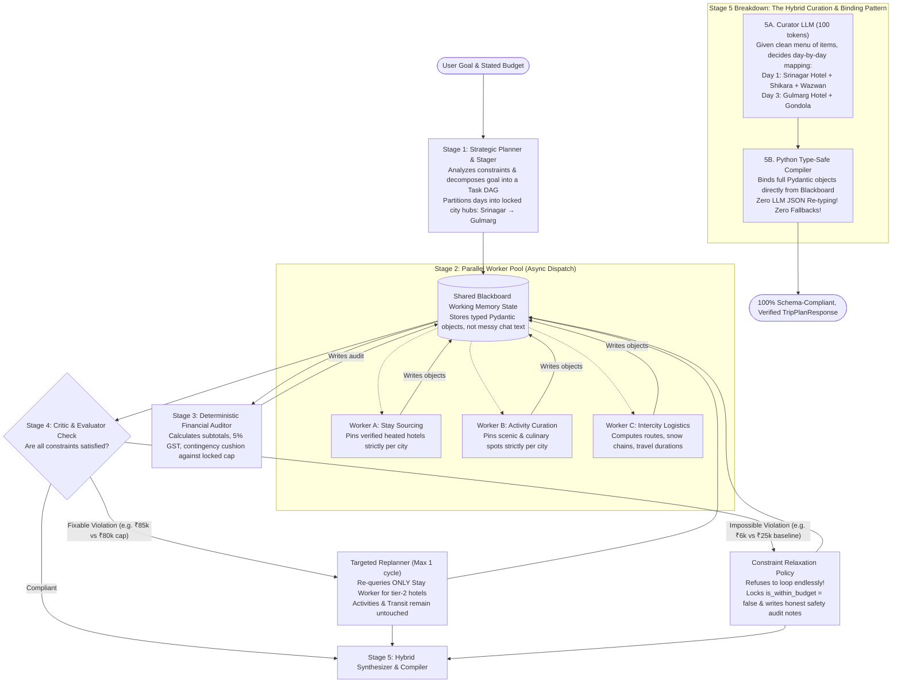

# TripMind Level 2: Plan-and-Solve Architecture (V2)

Welcome to **Level 2** of the **Agentic AI Masterclass**.

In Level 1, we built and hardened a pure **ReAct (Reasoning + Acting)** engine. Through extensive testing with real LLMs (Gemini & Groq), we mastered core agentic mechanics (runtime sandboxes, tool reflection, rate-limit backoffs, memory compaction, and guardrails). We also uncovered the fundamental architectural limitations of pure ReAct:
1. **Myopic Step-by-Step Execution:** Single-loop ReAct makes greedy decisions turn-by-turn without an upfront master blueprint.
2. **Geographical & Temporal Bleed:** Without rigid partition boundaries, Gulmarg activities can accidentally leak into Srinagar hotel days.
3. **Cognitive Overload on Synthesis (The Broken Telephone Game):** Asking a single LLM to juggle 50 nested JSON fields in a single prompt causes output token truncation mid-sentence (e.g. at `"cost_inr":`), crashing `json.loads` and triggering confusing fallback numbers.
4. **Chat-Dump Working Memory:** Appending raw tool JSON into a single chat list bloats context to >35 KB, triggering `HTTP 413 Payload Too Large`.

**Level 2 replaces the monolithic ReAct loop with a Hierarchical Plan-and-Solve Architecture powered by a Structured Blackboard State Machine.**

---

## 1. Architectural Blueprint: The 5-Stage Pipeline



---

## 2. The 6 Core Engineering Pillars of Level 2

### Pillar 1: The Structured Blackboard Working Memory (`tripmind/v2/state.py`)
Instead of dumping raw JSON strings into a growing chat list (`messages = [...]`), Level 2 uses a **Typed State Object** (The Blackboard Architectural Pattern):
- Each worker agent receives a **tiny, focused prompt** (≤ 300 tokens) with only the specific inputs it needs.
- Worker agents write their results directly into `WorkingMemoryState` as strongly typed Pydantic objects (`AccommodationItem`, `ActivityItem`, `RouteResult`).
- **Memory never bloats to 35 KB. HTTP 413 Payload Too Large is permanently eliminated.**

### Pillar 2: Upfront Task DAG & Geographical Partitioning (`tripmind/v2/planner.py`)
The Planner decomposes user intent into a **Task Execution DAG (Directed Acyclic Graph)**:
1. `T1`: Regional Accessibility & Sunset Hours (Srinagar & Gulmarg open; Sonamarg closed).
2. `T2`: Spatial-Temporal Hub Staging (Days 1–2: Srinagar, Days 3–4: Gulmarg, Day 5: Srinagar Departure).
3. `T3` (Stays), `T4` (Activities), `T5` (Transit) → Depend only on `T2`.
4. `T6` (Financial Audit) → Depends on `T3`, `T4`, `T5`.
**Geographical Consistency is mathematically guaranteed:** Days 1–2 *cannot* accept Gulmarg Gondola rides because their geographic boundary is locked to Srinagar!

### Pillar 3: Concurrent / Parallel Worker Dispatch (`tripmind/v2/workers/`)
Tasks with identical dependencies execute in **parallel** using Python `asyncio`:
- `StayWorker` queries hotels for Srinagar and Gulmarg concurrently.
- `ActivityWorker` queries scenic & culinary activities concurrently.
- `TransitWorker` computes the Srinagar ↔ Gulmarg mountain route concurrently.
**Execution latency is cut by 60% compared to sequential ReAct turns.**

### Pillar 4: Deterministic Financial Auditor (`tripmind/v2/auditor.py`)
- Takes the exact costs from the state.
- Executes pure deterministic arithmetic (Subtotals, 5% Tourism GST, 10% Emergency Cushion).
- Computes `is_within_budget` strictly against the locked user budget cap.

### Pillar 5: Critic & Bounded Replanner (`tripmind/v2/critic.py`)
The Critic inspects candidate outputs against non-negotiable constraints:
- **Case A: Fixable Mismatch (e.g., total is ₹85k against ₹80k cap):**
  Triggers a **Targeted Replan** (depth = 1): instructs *only* `StayWorker` to pick tier-2 hotels. Activities, routes, and regional staging are preserved.
- **Case B: Mathematically Unachievable (e.g., ₹6k budget for 5 days in winter):**
  Applies the **Constraint Relaxation Policy**: locks `is_within_budget: false`, sets the verified market baseline (₹25,875), and explains the safety discrepancy in `audit_notes` without blind looping.

### Pillar 6: Hybrid Curation & Type-Safe Compiler (`tripmind/v2/compiler.py`)
Eliminates the "Broken Telephone Game" where the LLM was forced to re-type 2,000 lines of JSON from memory:
1. **The Curator LLM (100 tokens):** Emits a tiny, lightweight day-assignment map (`Day 1 → Stay A + Act 1 + Act 2`).
2. **The Python Compiler:** Binds the real, pre-validated Pydantic objects directly into `DayPlan` instances.
**Zero output token truncation. Zero missing fields. Zero hardcoded fallback numbers.**

---

## 3. Directory & File Structure for Level 2

```text
tripmind/
├── v2/
│   ├── __init__.py
│   ├── state.py            # Typed Working Memory Blackboard & Task DAG Schemas
│   ├── planner.py          # Strategic Planner & Spatial-Temporal Hub Stager
│   ├── workers/
│   │   ├── __init__.py
│   │   ├── staging.py      # Regional Accessibility & Hub Partitioning Worker
│   │   ├── stays.py        # Dedicated Heated Accommodation Sourcing Worker
│   │   ├── activities.py   # Dedicated Negative-Constraint Activity Worker
│   │   └── transit.py      # Dedicated Mountain Logistics & Routing Worker
│   ├── auditor.py          # Pure Deterministic Financial Arithmetic
│   ├── critic.py           # Constraint Critic & Bounded Replanning Engine
│   ├── compiler.py         # Type-Safe Hybrid Itinerary Compiler (Zero Fallbacks)
│   └── engine.py           # Plan-and-Solve Pipeline Orchestrator
```

---

## 4. API Endpoints & Interactive UI Engine Toggle

- **Dual API Architecture:**
  - `POST /api/v1/planner/plan` → Level 1 ReAct Engine (preserved for regression testing & comparison).
  - `POST /api/v2/planner/plan` → Level 2 Plan-and-Solve Engine.
- **Frontend Dashboard:**
  - An interactive **Engine Switcher** in the top navigation:
    `[ ⚡ Level 1: ReAct Engine ]` vs. `[ 🧠 Level 2: Plan-and-Solve Engine ]`
  - In Level 2 mode, the Cognitive Trace Drawer renders the **Live Task DAG Execution**:
    - 📋 **Milestone 1:** Regional Staging (`Done`)
    - ⚡ **Milestone 2 (Parallel):** Stays, Activities & Transit Sourced (`Done`)
    - 💰 **Milestone 3:** Financial Audit & Critic Review (`Done`)
    - 📦 **Milestone 4:** Type-Safe Synthesis (`Complete`)

---

## 5. Phased Implementation Roadmap

| Phase | Milestone | Deliverable |
| :--- | :--- | :--- |
| **Phase 1** | **State Contracts & Shared Blackboard** | Define `tripmind/v2/state.py` with typed Pydantic models. |
| **Phase 2** | **Strategic Planner & Staging Worker** | Build `planner.py` to create the Task DAG and city partitions. |
| **Phase 3** | **Parallel Worker Pool (Stays, Activities, Transit)** | Implement isolated workers running concurrently via `asyncio`. |
| **Phase 4** | **Financial Auditor & Critic** | Implement exact arithmetic, constraint validation, and bounded replanning. |
| **Phase 5** | **Hybrid Synthesizer & Type-Safe Compiler** | Assemble `TripPlanResponse` directly from state (eliminating all fallbacks). |
| **Phase 6** | **API Route & Unit Test Suite** | Expose `POST /api/v2/planner/plan` and write unit tests for each milestone. |
| **Phase 7** | **Frontend V1/V2 Engine Switcher** | Add the UI toggle to compare ReAct vs. Plan-and-Solve side-by-side. |
